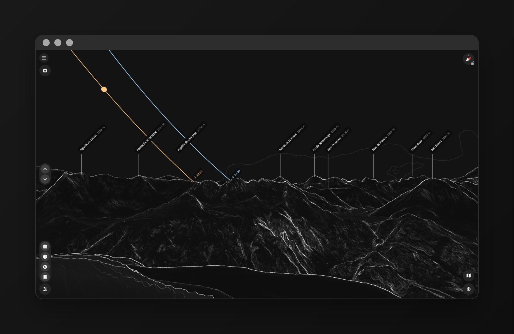
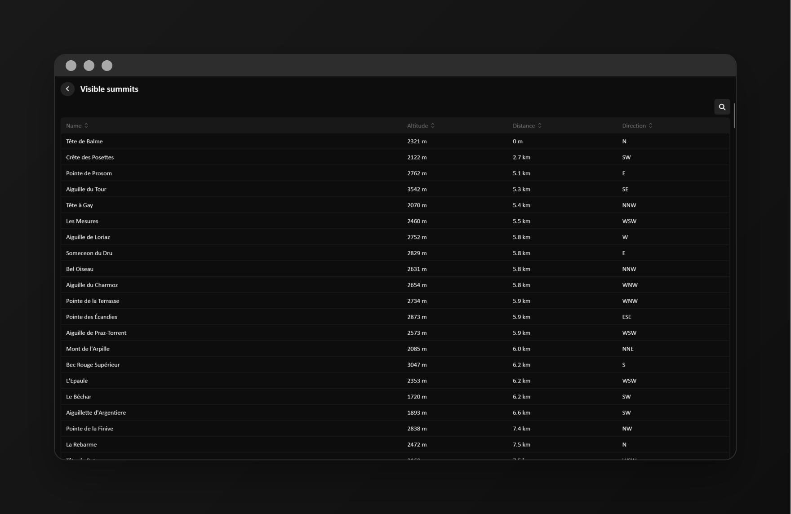
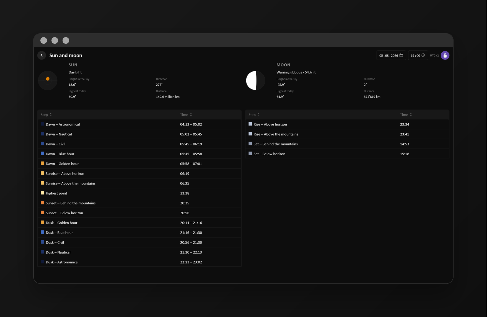
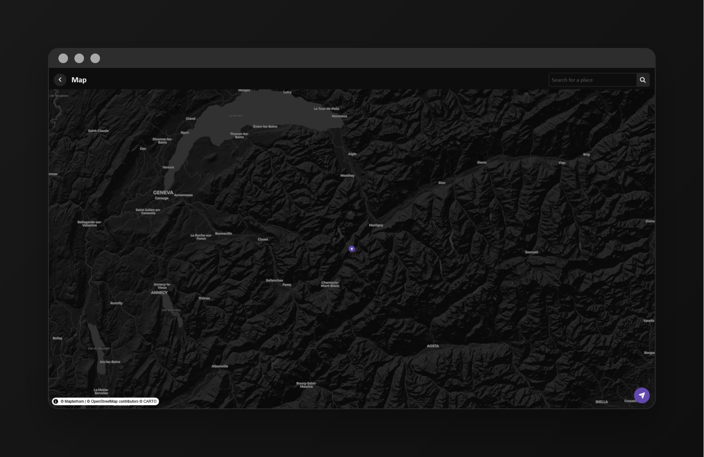

# Limina

## Introduction

**Limina names the mountains you can see.**

Limina draws the mountain skyline from any viewpoint and names the peaks you can actually see. It also shows the sun and moon, including their rise and set over the mountain skyline. Areas can be stored while connected to Wi-Fi and viewed later without a connection.

Live version: [limina.pixelpirate.fr](https://limina.pixelpirate.fr)

## Screenshots

<table>
  <tr>
    <td width="50%" align="center">
      
      <br />
      <sub><b>3D landscape</b> — visible peaks named, with the sun and moon tracks</sub>
    </td>
    <td width="50%" align="center">
      
      <br />
      <sub><b>Visible summits</b> — everything in sight, sortable and searchable</sub>
    </td>
  </tr>
  <tr>
    <td width="50%" align="center">
      
      <br />
      <sub><b>Sun and moon</b> — rise and set timed against the real skyline</sub>
    </td>
    <td width="50%" align="center">
      
      <br />
      <sub><b>Viewpoint picker</b> — shaded relief to help you locate the right place
    </td>
  </tr>
</table>

## Contributions

You can contribute to the application by creating a pull request. Contributions are welcome, including:

- Improvements and corrections
- New features
- Improvements to elevation or summit data
- New translations
- Documentation

If you're not familiar with coding, feel free to leave a message in the Issues or Discussions section.

## Development

This project is developed with [Angular](https://angular.dev/).

### Prerequisites

Make sure you have the following installed:

1. **Node.js & npm:** Download it [from here](https://nodejs.org/)
2. **Angular CLI:** Install it with:

    ```
    npm install -g @angular/cli
    ```

3. **PHP 8.1 or newer:** the summit and timezone APIs run on it. Download it
   [from here](https://www.php.net/downloads), or use any local stack that
   bundles it. These extensions must be enabled:

    - `pdo_sqlite` — the summit database
    - `curl` — downloading the summit data
    - `json` — API responses

    Check them with:

    ```
    php -m
    ```

    You will also need around 200 MB of free disk space for the summit database.

### Getting started

1. Clone the repository:

    ```
    git clone https://github.com/pixlpirate/limina.git
    cd limina
    ```

2. Install project dependencies:

    ```
    npm install
    ```

3. Load the summit database and start the API. From the `server` directory:

    ```
    php world-peaks.php
    php -S 127.0.0.1:8801 -t .
    ```

    See [server/README.md](server/README.md) for the full guide. The app runs
    without this, but no summits or sunrise times will appear.

4. Run the development server, in another terminal:

    ```
    ng serve
    ```

5. Open `http://localhost:4200/` in your browser. The application will automatically reload if you change any of the source files.

### Build

Run `ng build` to build the project. The build artifacts will be stored in the `dist/` directory.

## Data

Limina uses open elevation and summit data to generate its views.

The application calculates visibility using the terrain between the viewpoint and each summit, so mountains hidden behind closer terrain are excluded from the rendered skyline.

## License

This project is distributed under the GNU GPLv3 license.
You can redistribute and/or modify it under the terms of the GNU General Public License as published by the Free Software Foundation. More information is available in the attached license file.
